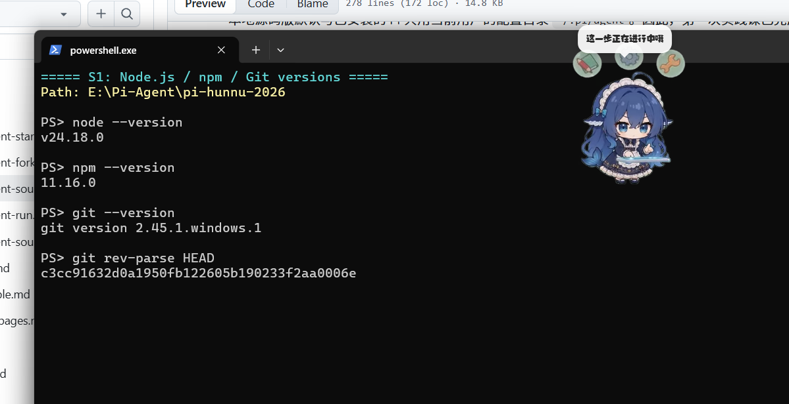
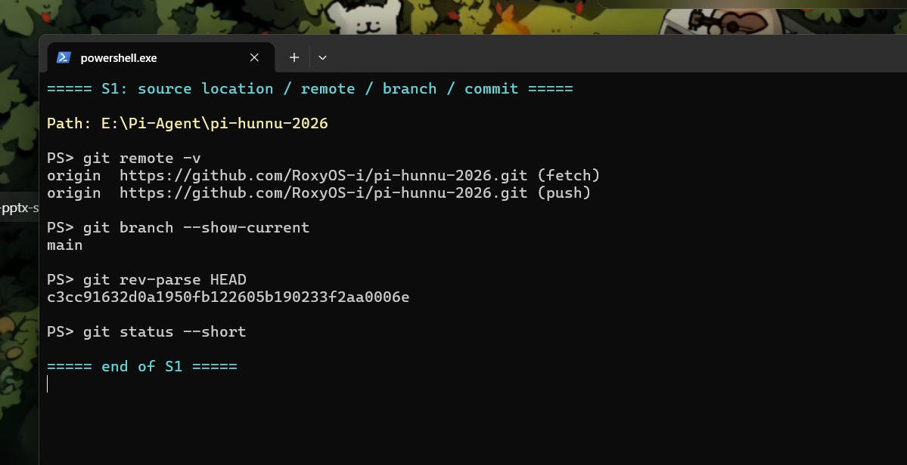
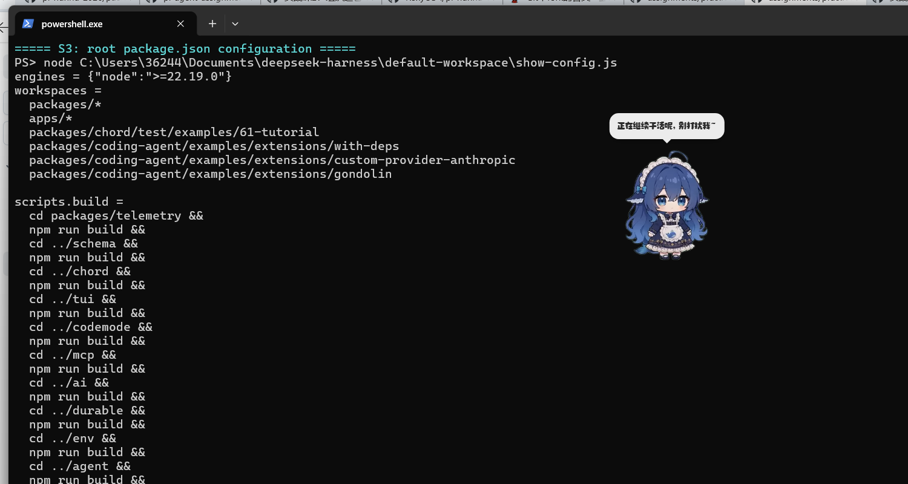
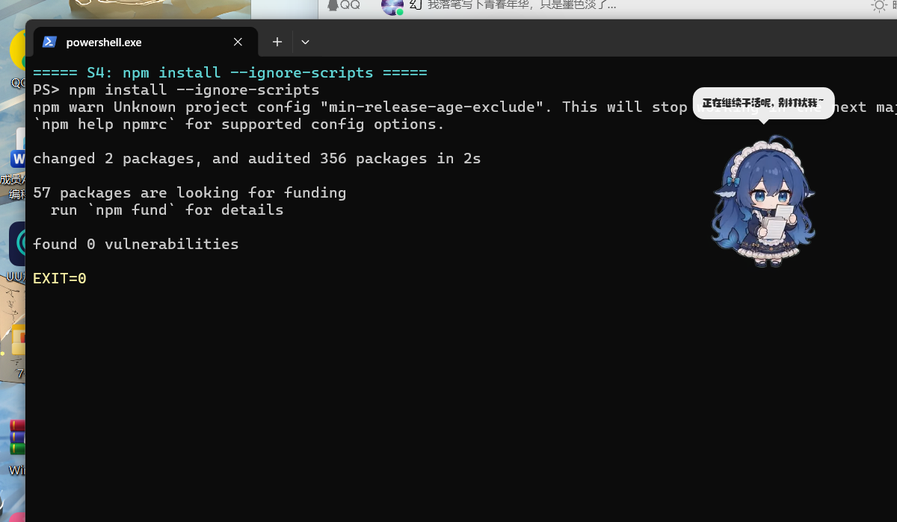
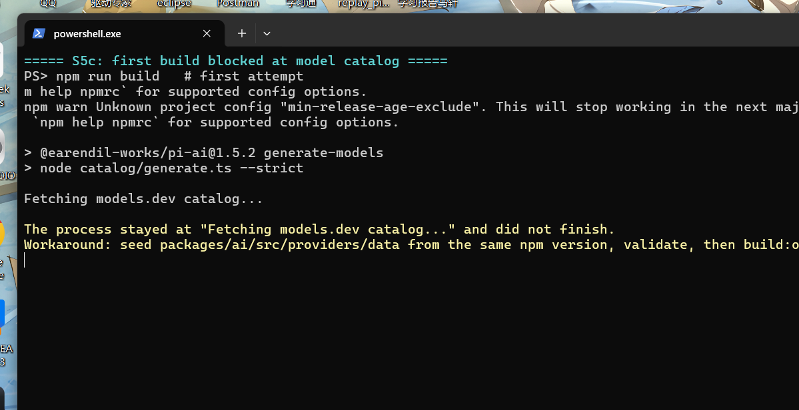
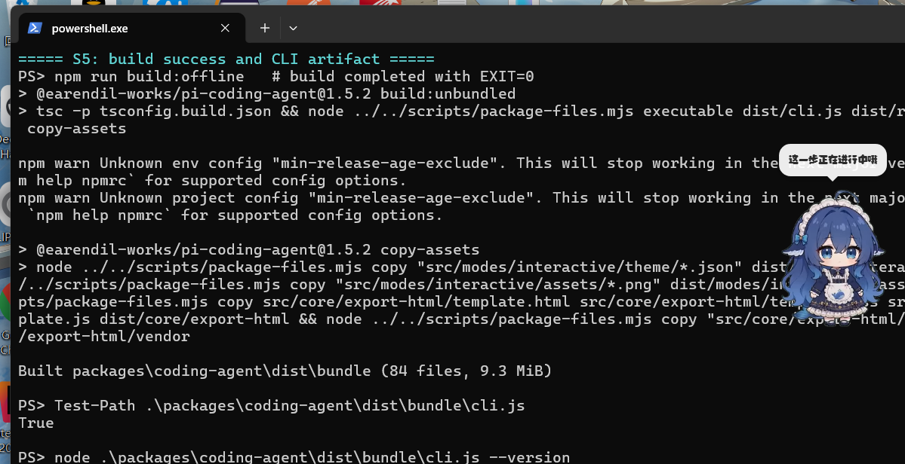
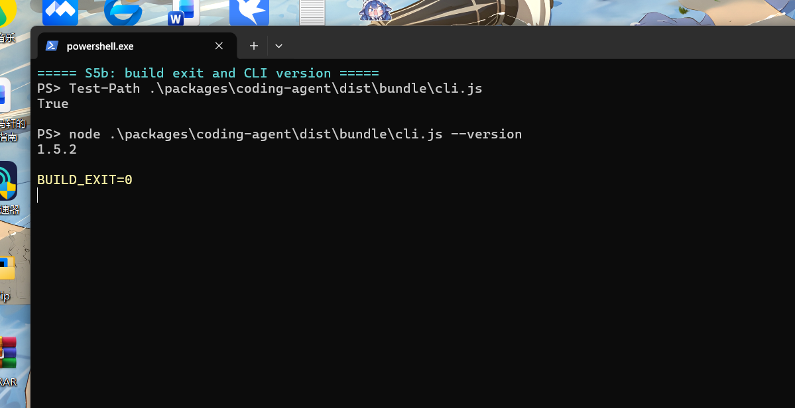
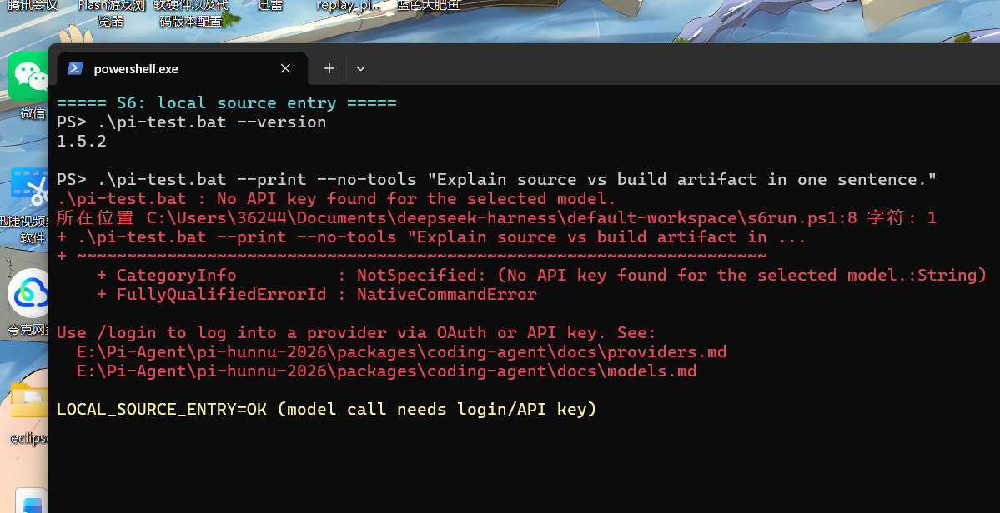

# 实践课 3：Pi Agent 源码安装与编译

- 姓名：马轩
- 班级：软件一班
- 学号：202430224041
- 小组组织：RoxyOS-i
- 小组仓库：https://github.com/RoxyOS-i/pi-hunnu-2026
- 实验日期：2026-11-26

## 一、实验环境

在 PowerShell 中执行：

```powershell
node --version
npm --version
git --version
```

实际结果：

```text
Node.js: v24.18.0
npm:     11.16.0
Git:     2.45.1.windows.1
```

项目根 `package.json` 的 `engines.node` 要求为：

```json
"node": ">=22.19.0"
```

当前 Node.js 24.18.0 满足要求。



## 二、源码位置与版本

源码目录：

```text
E:\Pi-Agent\pi-hunnu-2026
```

使用小组组织 fork 克隆：

```powershell
git clone --depth 1 --branch main https://github.com/RoxyOS-i/pi-hunnu-2026.git
```

检查结果：

```text
Path:   E:\Pi-Agent\pi-hunnu-2026
origin: https://github.com/RoxyOS-i/pi-hunnu-2026.git
branch: main
commit: c3cc91632d0a1950fb122605b190233f2aa0006e
status: 工作区干净
```



这里的 `--depth 1` 只拉取当前提交，适合本次“安装、构建、运行”实验；如果需要查看完整历史，应使用完整克隆。

## 三、阅读配置：安装和编译的依据

### 1. `engines`

根 `package.json`：

```json
"engines": {
  "node": ">=22.19.0"
}
```

### 2. `workspaces`

```json
"workspaces": [
  "packages/*",
  "apps/*",
  "packages/chord/test/examples/61-tutorial",
  "packages/coding-agent/examples/extensions/with-deps",
  "packages/coding-agent/examples/extensions/custom-provider-anthropic",
  "packages/coding-agent/examples/extensions/gondolin"
]
```

说明这是 npm workspaces 管理的 monorepo，依赖应从根目录统一安装。

### 3. `scripts.build`

根 `package.json` 的 `build` 不是一条 `tsc`，而是按顺序进入各子包：

```text
telemetry → schema → chord → tui → codemode → mcp
→ ai → durable → env → agent → coding-agent
```

每个子包再读取自己的 `package.json` 和 `tsconfig.build.json`，把 `src/` 编译到 `dist/`。`&&` 表示前一步成功后才执行下一步。



因此：

- Node.js 版本要求来自根 `package.json` 的 `engines`；
- `npm run build` 的命令来自根 `package.json` 的 `scripts.build`；
- 具体编译工作由各子包的 build 脚本和 `tsconfig.build.json` 决定。

## 四、安装依赖

在仓库根目录执行：

```powershell
npm install --ignore-scripts
```

实际结果：

```text
added 333 packages, and audited 356 packages in 47s
57 packages are looking for funding
found 0 vulnerabilities
EXIT=0
```

`--ignore-scripts` 的作用是跳过安装阶段自动执行的 `postinstall`、`prepare` 等生命周期脚本，不影响后续主动执行 `npm run build`。

本次没有使用 `-g`，所以：

- 依赖安装在当前项目的 `node_modules`；
- 不会把本地修改后的 Pi 安装成全局 `pi` 命令；
- 不会覆盖第一次实践课安装的全局版本。



## 五、本地编译与产物验证

### 1. 第一次 `npm run build` 遇到的困难

第一次在根目录执行：

```powershell
npm run build
```

构建进入 `@earendil-works/pi-ai` 后停在：

```text
> @earendil-works/pi-ai@1.5.2 generate-models
> node catalog/generate.ts --strict

Fetching models.dev catalog...
```

该步骤需要访问外部模型目录接口。当前终端网络无法完成该请求，构建长时间没有继续，因此第一次 `npm run build` 没有完成。



### 2. 解决方式

为了在本地完成构建，我从同版本已发布的 npm 包 `@earendil-works/pi-ai@1.5.2` 中取出已经生成的模型数据，放入：

```text
packages/ai/src/providers/data/
```

该目录在 `.gitignore` 中，属于本地生成数据，不是源码修改。

然后校验：

```powershell
cd packages\ai
npm run check:model-data
```

输出：

```text
Generated model data is valid.
```

再回到根目录执行：

```powershell
npm run build:offline
```

`build:offline` 复用已有模型目录数据，不再重新访问 models.dev，但仍会重新编译各包。

### 3. 构建结果

构建结束：

```text
Built packages\coding-agent\dist\bundle (84 files, 9.3 MiB)
EXIT=0
```

检查入口：

```powershell
Test-Path .\packages\coding-agent\dist\bundle\cli.js
```

输出：

```text
True
```

运行编译产物：

```powershell
node .\packages\coding-agent\dist\bundle\cli.js --version
```

输出：

```text
1.5.2
```





### 4. `src` 和 `dist` 的区别

- `src/`：TypeScript 源码，开发时修改这里；
- `dist/`：`tsc`/打包脚本生成的 JavaScript、类型声明和 bundle；
- 直接修改 `dist/` 可能在下次构建时被覆盖；
- 运行 `cli.js` 验证的是构建产物，运行 `pi-test.bat` 验证的是本地源码入口。

## 六、启动本地源码版本

### 1. 本地源码入口版本

```powershell
.\pi-test.bat --version
```

输出：

```text
1.5.2
```

说明 `pi-test.bat` 能启动本地源码对应的 CLI。

### 2. 非交互模式尝试

```powershell
.\pi-test.bat --print --no-tools "Explain source vs build artifact in one sentence."
```

当前环境没有配置模型 API Key，输出：

```text
No API key found for the selected model.
Use /login to log into a provider via OAuth or API key.
```



因此：

- **本地源码程序启动成功**；
- **模型调用没有完成**，原因是当前账号没有可用的 provider 凭据，而不是编译失败。

要完成一次真实模型会话，需要先执行：

```powershell
.\pi-test.bat
```

在 Pi 中执行 `/login`，或配置对应 provider 的 API Key 后再发送问题。

### 3. 如何确保运行的是本地源码

- `.\pi-test.bat --version` 和 `.\pi-test.bat` 调用仓库里的 `.ps1`，由 Node.js 加载 `packages/coding-agent/src/cli.ts`；
- 直接输入 `pi` 可能启动第一次实践课安装的全局版本；
- `node .\packages\coding-agent\dist\bundle\cli.js` 运行的是本次构建产物；
- 日常开发用 `pi-test.bat`，验证发布 bundle 用 `dist/bundle/cli.js`。

## 七、遇到的困难与解决

| 困难 | 现象 | 解决 |
|---|---|---|
| GitHub 连接不稳定 | `git clone` 偶尔 `Failed to connect`/连接重置 | 重试 `git clone`，必要时用 codeload 压缩包获取源码 |
| PowerShell 执行策略 | `npm.ps1` 被禁止运行 | 使用 `npm.cmd` 执行 npm 命令 |
| 模型目录接口不可达 | `npm run build` 停在 `Fetching models.dev catalog...` | 从同版本 npm 包取出模型数据，`check:model-data` 通过后执行 `build:offline` |
| 无模型凭据 | `No API key found for the selected model` | 需要 `/login` 或配置 provider API Key；本次先记录为未完成项 |

其中第三个问题是本次构建的核心困难：`npm run build` 的失败点不在 TypeScript 编译，而在 `ai` 包的模型目录生成阶段；把“源码能否编译”和“外部模型目录接口是否可达”分开记录，才能避免误判。

## 八、当前完成情况

已完成：

- Node.js、npm、Git 版本检查；
- 小组 fork 源码下载；
- 根配置阅读；
- `npm install --ignore-scripts`；
- 模型数据校验；
- `npm run build:offline` 构建成功；
- `dist/bundle/cli.js` 存在且版本为 1.5.2；
- `pi-test.bat --version` 本地源码入口验证。

尚未完成：

- 一次真实的模型问答会话，因为当前环境没有 API Key；
- 重新执行一次不依赖预置模型数据的全新 `npm run build`（需要能访问 models.dev 的网络环境）。

## 九、提交信息

- 小组仓库：https://github.com/RoxyOS-i/pi-hunnu-2026
- 个人报告仓库：https://github.com/RoxyMax1173/pi-agent-assignment-03
- 课程 Issue：审核通过后再提交
